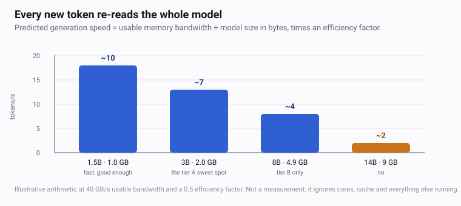

# 02.1 · Memory bandwidth sets your speed

Every generated token re-reads the entire model from RAM. That single sentence is the reason a
Raspberry Pi 5 answers at 4.8 tokens per second with a 3B model while a Framework mainboard with
the same file manages 13.1 — a difference of almost three, bought entirely by memory and not by
the processor. Once you can see that, the fastest way to make a home AI machine feel faster is not
a new CPU. It is a second memory module.

## Why it matters

This is the lesson that turns the rest of the course from a sequence of instructions into a
method. Once you can predict a speed before you download anything, you can choose a model by
arithmetic, explain to a colleague why their machine is slow, and decide whether an upgrade is
worth money. Without it, model choice is a matter of taste and every disappointment is a surprise.

It also explains the single most common home-lab fault. A desktop built with one 16 GB stick in
one slot has one memory channel instead of two. Nothing in the operating system says so, no
application complains, and every model is roughly twice as slow as the same model on the same
processor with two sticks. [02 · Find your tier with homelab doctor](../module-00/lesson-02.md)
prints `memory channels: unknown` on Windows and macOS for exactly this reason.

## How it works



### The rule, and where it comes from

To produce one token, the model multiplies every weight by an activation: one pass over the
weights, one multiply-accumulate per weight, and then it stops. So the work per token is
proportional to the number of parameters — and the data that has to arrive is the whole weight
file, every time.

A modern CPU can perform tens of billions of those multiply-accumulates per second. Memory cannot
feed it that fast. The arithmetic per byte is so low — roughly one multiply-accumulate per byte
read — that the processor spends nearly all of its time waiting. This is the definition of a
bandwidth-bound workload, and it is why a faster processor with the same memory does not help
much, while faster memory with the same processor does.

$$\text{tokens/s} \;\approx\; \frac{\text{usable bandwidth in bytes/s}}{\text{bytes read per token}} \;\times\; e$$

where $e$ is an **efficiency factor** — the fraction of your peak bandwidth the runtime actually
achieves, after refresh overheads, cache misses and the bytes spent on something other than
weights. Treating it as roughly 0.5 is a *starting assumption to be calibrated*, not a constant,
and [08 · Measure prompt speed and generation speed](../module-02/lesson-03.md) is where you
replace it with your own number.

And one correction to "bytes read per token" that matters: it is the weights **plus the KV cache**,
which is the *hot context* — the tokens the model has to re-read on every single token of the
reply. A longer conversation does not just use more memory, it reads more bytes per token. That is
why the oversized context in [05 · Settings that change the answer](../module-01/lesson-03.md) was
slow and not merely large.

### Your machine's peak bandwidth

Peak bandwidth is a multiplication: transfer rate × bus width × channels. A 64-bit channel moves
8 bytes per transfer, and DDR5 splits each channel into two 32-bit sub-channels that both run at the
full rate — which is why a single DDR5 stick is much faster than a single DDR4 stick.

| Memory in the machine | Per channel | Two channels |
|---|---|---|
| DDR4-3200 | 25.6 GB/s | 51.2 GB/s |
| DDR5-5600 | 44.8 GB/s | 89.6 GB/s |
| DDR5-6000 | 48.0 GB/s | 96.0 GB/s |
| LPDDR4X-4266 (Raspberry Pi 5, 32-bit bus) | 17.1 GB/s | not applicable — one channel by design |

So the predicted ceiling for a 3B model on a dual-channel DDR5-5600 laptop is
$89.6 \times 0.5 \div 2.0 \approx 22$ tokens per second, and on a single-channel machine of the
same processor it is about half that, before any other difference.

### Checking the rule against published measurements

The Raspberry Pi 5 is the useful calibration machine, because its memory specification is public
and fixed, and because four models were measured on it. The file sizes are the course's
[Q4_K_M figures](../../references/models.md); the speeds are from
[Stratosphere's Pi 5 study](https://stratospherelinuxips.readthedocs.io/en/develop/immune/research_rpi_llm_performance.html).

| Model on a Raspberry Pi 5 | File | Predicted at $17.1 \times 0.5$ | Measured, cited |
|---|---|---|---|
| Gemma 3 1B | 0.8 GB | 10.7 tok/s | 11.5 tok/s |
| Llama 3.2 1B | 0.8 GB | 10.7 tok/s | 11.2 tok/s |
| Qwen2.5 1.5B | 1.0 GB | 8.6 tok/s | 10.0 tok/s |
| Llama 3.2 3B | 2.0 GB | 4.3 tok/s | 4.6–4.9 tok/s |
| Qwen2.5 3B | 2.0 GB | 4.3 tok/s | 5.2 tok/s |

The prediction is within about 20% of the measurement in every row, which is the point: the
arithmetic carries real information, and $e = 0.5$ is a defensible first guess for a memory-bound
workload on a machine with no GPU. It is still a guess, and the same $e$ will not fit a different
machine, a different runtime or a different context length — the study's numbers were taken at
whatever context it used, and a longer context adds KV cache to every token.

The same rule, tested on a completely different machine: Llama 3.1 8B at Q4_K_S is 4.4 GiB and
manages 9.6 tok/s of generation on a Ryzen 9 7950X
([ik_llama.cpp discussion #164](https://github.com/ikawrakow/ik_llama.cpp/discussions/164)). With
dual-channel DDR5-5600 — an assumption, because the source does not state the memory — the
prediction is $89.6 \times 0.5 \div 4.4 = 10.2$ tok/s. The rule holds on a completely different
architecture, which is a good reason to trust its *shape* and be careful with its absolute value.

### Single channel versus dual channel

This is the whole table above, read one row down. One 64-bit channel moves what one channel moves;
a second channel in the paired slot doubles it, and the CPU can pull roughly twice as many bytes
per second. Generation speed follows, because generation is bandwidth-bound. Nothing else changes:
the processor is the same, the model is the same, the operating system does not warn you, and
`homelab.py doctor` reports `unknown`.

Three practical consequences:

1. **Two sticks in the wrong slots is the same as one stick.** Consumer boards pair channels by
   slot: a two-channel board has slots A1/A2 and B1/B2, and the matching pair is usually A2 and
   B2. Two sticks in adjacent slots can leave the board in single-channel mode while the vendor
   box says 32 GB.
2. **Matching is better than merely having two.** Two different sticks run at the speed of the
   slower one, and some boards refuse to enable the second channel at all when the modules differ.
3. **Laptops with soldered memory are usually already dual-channel**, and a small-board machine
   like the Pi 5 is single-channel *by design* — its 17.1 GB/s is a deliberate choice that traded
   bandwidth for a cheap, small, cool board.

### Why more than about four to eight threads does not help generation

A generation step is not one big parallel job. It walks the model's layers in order, and within
each layer it is a sequence of matrix operations on a batch of one token. There is some
parallelism to exploit — and you see the first few steps of it in a thread sweep — but once the
memory controller is saturated, extra threads queue for the same bus. Past that point they add
scheduling and synchronisation overhead, and generation stops improving or even gets slightly
worse.

The clearest published example is the thread sweep in
[llama-bench's own documentation](https://github.com/ggml-org/llama.cpp/blob/master/tools/llama-bench/README.md),
on a 7B Q4_0 model. The documentation does not name the machine, so read the shape and not the
numbers:

| Threads | `tg 16` — generation | `pp 64` — prompt processing |
|---|---|---|
| 1 | 4.05 tok/s | 6.17 tok/s |
| 2 | 7.80 | 12.31 |
| 4 | 12.22 | 23.18 |
| 8 | 16.71 | 32.29 |
| 16 | 15.32 | 33.52 |
| 32 | 16.41 | 59.00 |

Generation doubles from 1 to 4 threads, gains a little more to 8, and then goes flat. Prompt
processing is still climbing at 32. Two different limits, two different curves, and the second
one is the one that matters for long documents.

### Prompt processing is a different limit

Prompt processing runs the same weights over a *batch* of hundreds of tokens at once, which turns
a latency-bound memory walk into ordinary compute: high arithmetic intensity, vectorised, and
scaling with cores and instruction sets. That is why the cited prompt rates look nothing like the
generation rates — 108 tok/s at `pp512` on a Ryzen 9 7950X, and 31–36 tok/s on a Ryzen AI laptop
([mgroeber](https://www.mgroeber.de/benchmarking-llamacpp-on-legacy-hardware-2.html)) — and why
they are so much higher than generation on the same machines.

**And this is where long prompts hurt.** Do the arithmetic on the two cited prompt rates: 2 000
prompt tokens is between 18 and 65 seconds of processing before the first word of the answer
appears. [The benchmark reference](../../references/benchmarks.md) rounds that to 20–60 seconds and
calls it the most common cause of "my local AI feels broken". A retrieval-augmented question in
Module 6 carries a few thousand prompt tokens by construction, which is why the fastest model you
own is not automatically the best one for that job — and why [09 · Pick the largest model that
meets your target](../module-02/lesson-04.md) treats prompt speed as a separate target from
generation speed.

## Show me

The three facts to carry forward, and where each comes from:

1. **Generation is bandwidth-bound.** The same 3B model, three machines: 4.6–4.9 tok/s on a
   Raspberry Pi 5, 9.1 on an Intel N150, 13.1 on a Framework Ryzen mainboard (Stratosphere and
   [Geerling's ai-benchmarks](https://github.com/geerlingguy/ai-benchmarks)). The model was not the
   variable; the memory was.
2. **Channels matter more than cores.** One DIMM is one channel. This is the cheapest performance
   change available to a home AI machine and the one nobody makes.
3. **Cores matter for prompt processing.** Doubling the cores roughly doubles prompt throughput and
   does nothing for generation past about eight threads.

And the two things this course will not do: quote a speed without the machine it was measured on,
and call a prediction a measurement. Every number in the table above is somebody else's, and the
only numbers that will be in your measure-yours table are the ones you produced.

## Try it

Do the arithmetic for your own machine before you measure anything. This is the prediction you will
check in [08 · Measure prompt speed and generation speed](../module-02/lesson-03.md), and
predicting first is what makes the difference between the two numbers explainable.

```text
My memory type and speed:     ____________  (DDR5-5600? DDR4-3200?)
My channels:                  1  /  2       (sticker on the module, or the spec sheet)
Peak bandwidth:               ______ GB/s   (peak per channel x channels)
My efficiency factor (start): 0.5           (to be replaced by your own measured value)

For a 2.5 GB model (qwen3:4b):
  predicted generation = ______ GB/s x 0.5 / 2.5 GB = ______ tok/s
For a 1.0 GB model (gemma3:1b):
  predicted generation = ______ GB/s x 0.5 / 1.0 GB = ______ tok/s
For a 4.9 GB model (llama3.1:8b):
  predicted generation = ______ GB/s x 0.5 / 4.9 GB = ______ tok/s
```

Then read what the machine actually reports, which is not the same as what the sticker says:

```powershell
# Windows PowerShell: modules, their speeds and their configured clocks
Get-CimInstance Win32_PhysicalMemory | Select-Object DeviceLocator, @{n='GB';e={[math]::Round($_.Capacity/1GB,1)}}, Speed, ConfiguredClockSpeed
```

```bash
# Linux: the same, plus how many channels the firmware reports
sudo dmidecode -t memory | grep -E "Size|Speed|Locator"
lshw -class memory -short 2>/dev/null | head -20
```

```bash
# macOS — not verified by us; the course has one Windows test machine
system_profiler SPHardwareDataType
```

`ConfiguredClockSpeed` is the number that matters on Windows: a module sold as DDR5-5600 running
at 4800 is a machine with 20% less bandwidth than the label suggests, and nothing will ever tell
you that except this command. Record what you found in
[the measure-yours table](../../templates/measure-yours.md) next to the prediction, and leave the
measured column empty until the next lesson.

## Break it

**Break it with one memory module.** Take a dual-channel desktop and use a single 16 GB stick in
slot A2. Same processor, same model, same operating system, same file. Generation speed roughly
halves. The machine feels broken in a way that is almost impossible to diagnose from inside,
because every diagnostic tool reports the processor as capable and the memory as sufficient. The
only clue is that the machine is slower than the benchmark for that processor, which is a clue
most people do not have.

**Break it with more cores.** Assume that a 16-core processor will be twice as fast as a 4-core
one for chat. Prompt processing agrees. Generation does not, once you are past about eight
threads, because the memory bus is already the constraint and the extra cores are queueing for
it. The clearest evidence in this course's own data is the pair of four-core machines: a
Raspberry Pi 5 and an Intel N150 differ by roughly 1.5× in memory bandwidth, and the same Llama
3.2 3B model runs at 4.6–4.9 tok/s on one and 9.1 tok/s on the other. The core count is identical
in both rows; the memory is not.

**Break it with a long prompt.** Take a machine that generates at 15 tok/s and ask it a question
that carries 2 000 prompt tokens. Generation speed is unchanged, and the user waits 18 to 65
seconds, by the arithmetic above, before anything appears. A machine that feels instant at 8 tokens
and dead at 2 000 is not broken; it is answering a much harder question.

**Break it with thermal throttling.** A laptop that is fast when cold and slower after ten minutes
of generation is not a bandwidth problem any more — it is a clock problem, and the fix is airflow,
not another DIMM. Watch the clock during a run, not at idle.

## Fix it

1. **Count the channels before you buy anything.** Two matching modules in the paired slots. This
   is the highest-value upgrade in the whole course and it costs less than a model.
2. **Size the model to the bandwidth, not to the RAM.** The file has to be small enough that
   bandwidth ÷ file size is a speed you can live with. That is the whole of
   [09 · Pick the largest model that meets your target](../module-02/lesson-04.md).
3. **Keep the hot context small.** Fewer bytes per token means faster tokens *and* less memory.
   Context is a bandwidth decision as much as a memory decision.
4. **Use the threads for what they are good at.** Leave `num_thread` at your physical core count;
   do not chase more. If you have long prompts and a spare core budget, the win is in prompt
   throughput, not in chat.
5. **Rule out the boring causes before the interesting ones.** Swapping, a hot CPU, a busy
   machine, a browser with too many tabs. [The troubleshooting
   page](../../references/troubleshooting.md) lists them; the interesting causes are the ones you
   check *after* the boring ones.

## How do I know it works?

- [ ] You can state your machine's peak bandwidth in GB/s and show the multiplication that got
      there.
- [ ] You know your channel count from evidence — the module stickers, the board layout or the
      specification — not from `doctor`, which reports `unknown` on Windows and macOS.
- [ ] You have a written prediction for two models, and they are in
      [the measure-yours table](../../templates/measure-yours.md) next to empty measured columns.
- [ ] You can explain in two sentences why eight threads and sixteen threads give the same
      generation speed, and why prompt processing keeps improving.
- [ ] You can do the 2 000-prompt-token arithmetic for your own prompt throughput before you have
      measured it.

## Use it when / avoid it

**Use this model whenever you choose a model, and whenever you are tempted to blame your machine.**
It answers "will this be usable here" in three multiplications, before a multi-gigabyte download.

**Use it to argue for hardware.** If somebody asks why their home AI is slow, the first question
is not "which CPU is that" but "how many memory modules are in it, and what speed". The second
question is "how long is the prompt".

**Avoid treating the efficiency factor as universal.** It is a placeholder until Module 2.3
replaces it with your own. A machine with a large L3 cache behaves differently from one without,
a newer instruction set changes prompt throughput substantially, and a very long context adds KV
cache to every token. Use the rule for ratios — half the bandwidth, half the speed; twice the
file, half the speed — and use your own measurement for absolute numbers.

**Avoid optimising the wrong half.** Most home AI is generation, so most home AI is bandwidth. The
exception is retrieval over your own files, where the prompt is thousands of tokens and prompt
throughput decides whether the feature is usable at all. Decide which half your problem is in
before you go looking for a faster processor.

**Avoid this lesson without the next one.** The prediction is half the work. The other half is
measuring, and the gap between the two is the most useful number in the course.

## Reflect

1. What is your machine's peak bandwidth, and what did the operating system say the modules were
      actually running at? Did those two numbers agree?
2. If you added a second matching module tomorrow, which number in the prediction would change,
      and which number in the RAM bill would not?
3. Choose a job you will actually do — chat, or a question over your files — and say which of the
      two limits it is bounded by, with the arithmetic.

## Sources

- [Stratosphere — LLM performance on Raspberry Pi 5, with the memory specification](https://stratospherelinuxips.readthedocs.io/en/develop/immune/research_rpi_llm_performance.html)
- [Geerling — ai-benchmarks on Pi 5, N150 and a Ryzen mainboard](https://github.com/geerlingguy/ai-benchmarks)
- [ik_llama.cpp discussion #164 — Llama 3.1 8B Q4_K_S on a Ryzen 9 7950X, 9.6 tok/s generation and 108 tok/s prompt](https://github.com/ikawrakow/ik_llama.cpp/discussions/164)
- [mgroeber — benchmarking llama.cpp on legacy hardware, prompt rates on a Ryzen AI laptop](https://www.mgroeber.de/benchmarking-llamacpp-on-legacy-hardware-2.html)
- [llama.cpp issue #1437 — memory bandwidth as the limit on generation](https://github.com/ggml-org/llama.cpp/issues/1437)
- [llama-bench documentation — the thread sweep used above](https://github.com/ggml-org/llama.cpp/blob/master/tools/llama-bench/README.md)
- [Benchmark numbers and where they come from](../../references/benchmarks.md)
