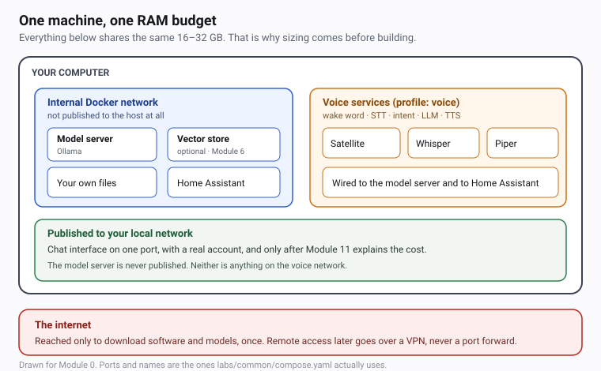
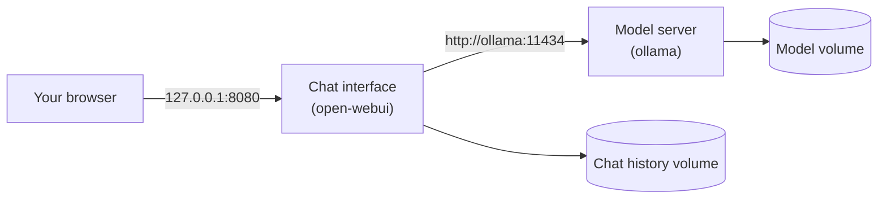

# 03.3 · The shared stack

Two services, one file, and a browser window with a local model answering in it. This is the moment
the course has been building towards, and it takes about ten minutes once the images are downloaded.
The interesting part is the network, because the same design keeps working when there are six
services instead of two.

## Why it matters

Everything after this module — your own files, your voice, Home Assistant — attaches to the same
two services. Get the topology right now and adding a service is a five-line change. Get it wrong
and every later module starts with a debugging session about why something cannot reach something
else.

It is also the first time the course's security default becomes real rather than theoretical: a
model server that the rest of your house cannot see, and a chat interface that only your laptop can
open.

## How it works

The stack map for the whole course, which grows module by module:



Two services to begin with, on one internal network called `ai`:



### The internal network, and the download problem

`ai` is declared `internal: true`. Docker attaches no gateway to an internal network, which means
containers on it can reach each other and **cannot reach the internet**. That is a feature: a
compromised web interface has no route to call home, and the model server cannot be used as a
relay.

It creates one real problem: **you cannot pull a model from inside the stack.** Pulling is the only
time the model server needs the internet, and the design answer is to make that a deliberate,
separate step rather than a permanent capability.

```bash
# one-time: download into the same named volume, on a network that has a route out
docker run --rm -v homelab-ollama-models:/root/.ollama ollama/ollama:0.35.0 ollama pull qwen3:4b
```

The `--rm` container attaches to Docker's default bridge, downloads the model into the volume, and
disappears. The long-running model server then runs with no route to the internet at all, reading a
model that is already there. Pulling a new model later is the same command with a different name.

> [!NOTE]
> If you followed Module 1, you already have a native Ollama with a model downloaded on the host.
> That installation keeps working and is the right tool for [14 · Talk to your model over
> HTTP](../module-04/lesson-01.md) and the benchmarks in Module 2. From here on the Compose stack is
> the one the rest of the course uses, and having both is fine and normal.

### Talking by service name

The chat interface finds the model server at `http://ollama:11434` — a name, not an IP address.
Docker's embedded DNS resolves service names to container addresses on the same network, so the
configuration survives a restart even though the underlying IP address changes.

This is also the answer to the most common problem in home AI setups, and the one in
[Troubleshooting](../../references/troubleshooting.md): **a container cannot reach the host's
`127.0.0.1`.** If you kept Ollama running natively on the host, Home Assistant in a container cannot
talk to it on loopback. Putting the model server *inside* the network is the fix that does not
require binding anything to `0.0.0.0`.

### What gets created on disk

| Volume | Holds | Size, roughly |
|---|---|---|
| `homelab-ollama-models` | Downloaded model weights | 1–5 GB per model |
| `homelab-open-webui-db` | Accounts, chat history, settings | A few hundred MB |
| `homelab-ha-config` | Home Assistant configuration and database | Grows over time |
| `homelab-qdrant-data` | The vector index | Rebuildable from your files |
| `homelab-whisper-models`, `homelab-piper-voices` | Speech models and voices | 0.1–2 GB |

Models are the big one and the only one you would re-download rather than back up. Module 2's RAM
bill and Module 12's backup lesson both depend on knowing that.

## Show me

The parts of `labs/common/compose.yaml` that matter for this module:

```yaml
  ollama:
    image: ollama/ollama:0.35.0
    restart: unless-stopped
    environment:
      OLLAMA_MAX_LOADED_MODELS: "2"
      OLLAMA_KEEP_ALIVE: "5m"
      OLLAMA_NUM_PARALLEL: "1"
    volumes:
      - ollama-models:/root/.ollama
    networks:
      - ai
    # No ports: line. Nothing outside this network can reach this API.

  open-webui:
    image: ghcr.io/open-webui/open-webui:v0.11.4
    environment:
      OLLAMA_BASE_URL: "http://ollama:11434"
      WEBUI_AUTH: "True"
      ENABLE_WEB_SEARCH: "False"
      ENABLE_CODE_EXECUTION: "False"
    volumes:
      - open-webui-db:/app/backend/data
    networks:
      - ai
    ports:
      - "${WEBUI_BIND:-127.0.0.1}:8080:8080"
    depends_on:
      ollama:
        condition: service_healthy
```

Four decisions worth being able to defend:

- **No `ports:` on the model server.** Its API has no authentication whatsoever — anyone who reaches
  it can list, pull, delete models and use your compute. It has to be unreachable from outside.
- **`WEBUI_AUTH: "True"`.** The chat interface is the one thing you will open from a browser, so it
  needs an account before it does anything.
- **Web search and code execution off.** Both send your prompt content to a third party or run code
  on the host. Neither is needed for a private stack, and Module 12 is where you *prove* the stack
  works with outbound traffic blocked.
- **`depends_on` with a health check**, not a sleep. Compose waits until the model server actually
  answers, so the first page load is not a race.

## Try it

1. Download the model into the stack's volume:

   ```bash
   docker run --rm -v homelab-ollama-models:/root/.ollama ollama/ollama:0.35.0 ollama pull qwen3:4b
   ```

   About 2.5 GB. Do it once. If you have a small machine, use `llama3.2:3b` instead — that is the
   tier A choice and it is about 2 GB.

2. Start the stack and follow the logs rather than guessing:

   ```bash
   docker compose up -d
   docker compose logs -f open-webui
   ```

   Stop following with <kbd>Ctrl</kbd>+<kbd>C</kbd>. That stops the log output, not the containers.

3. Open <http://127.0.0.1:8080> in your browser. The first screen asks you to create an account —
   this is the admin account, and the password becomes real immediately. Use a password from a
   password manager, not the one you are typing into right now.

   > [!CAUTION]
   > This account is the only thing between your chat history and anyone who can reach the port. It
   > binds to `127.0.0.1`, so on a home network only this computer can open it. Module 11 is where
   > you decide to widen that, and what it costs.

4. Ask it something that needs no facts: *"Explain in one sentence why memory bandwidth limits how
   fast a model can generate text."* If you get an answer, the whole path works: browser → chat
   interface → model server → weights on disk.

5. Check where things are listening, from the machine's own point of view:

   ```bash
   # Windows PowerShell
   Get-NetTCPConnection -State Listen | Where-Object { $_.LocalPort -in 8080,11434,8123 } |
     Select-Object LocalAddress, LocalPort, OwningProcess

   # macOS / Linux
   ss -tlnp | grep -E ':(8080|11434|8123)'
   ```

   `11434` should not appear at all. `8080` should be bound to `127.0.0.1`.

6. Run `python homelab.py doctor`. The model server line should read "loopback only" or report
   nothing, and there should be no `0.0.0.0` warning anywhere.

## Break it

**Break the network, gently.** Stop the model server and reload the chat interface:

```bash
docker compose stop ollama
```

The interface still loads — it is a separate container — but every message returns a connection
error. The error is on the *interface's* side even though the *cause* is the model server, and that
is worth noticing, because it is the shape most real failures take.

**Break it with a model that is not there.** Ask the interface for a model you never pulled. Some
clients fail with a clear "model not found"; others silently fall back to a default. If yours
silently substitutes something, the model list in the interface is where you will see the truth.

**Break it by publishing the port.** Temporarily change `.env`:

```dotenv
WEBUI_BIND=0.0.0.0
```

```bash
docker compose up -d
python homelab.py doctor
```

`doctor` now reports the chat interface as reachable from your network and fails on that line. That
is the tool earning its place. Put it back to `127.0.0.1` when you are done.

**The break you cannot do here.** Nothing in the core stack publishes the model server, so you
cannot accidentally expose it from this module. That is the point of the design, and it is why the
exposure lab in Module 11 has to build a deliberately wrong stack to demonstrate the problem.

## Fix it

| Symptom | Cause | Fix |
|---|---|---|
| Interface loads, every reply errors | Model server stopped, or the two are on different networks | `docker compose ps`; both should be on `ai` |
| "connection refused" from the interface | `OLLAMA_BASE_URL` is `127.0.0.1` | It must be `http://ollama:11434` — containers do not share a loopback |
| Interface says it has no models | The model was pulled on the host, not into the volume | Use the `docker run --rm -v` pull command above |
| Interface is slow on the first message | The model is loading from disk | Normal, once per model; `OLLAMA_KEEP_ALIVE` controls how long it stays |
| Browser cannot connect at all | The port is bound elsewhere, or Docker is not running | `docker compose ps`, then `docker compose logs open-webui` |
| Every reply is identical and silly | Temperature 0 from an old setting | Check `OLLAMA_BASE_URL`; a missing model name falls back to defaults |

The general fix for all of them is the same two commands, in this order:

```bash
docker compose config          # is the file what you think it is?
docker compose logs --tail=50  # what did the services actually say?
```

## How do I know it works?

- [ ] `docker compose ps` shows `ollama` and `open-webui` running and healthy.
- [ ] A browser at <http://127.0.0.1:8080> shows a local model answering a question.
- [ ] `python homelab.py doctor` reports no `0.0.0.0` warning.
- [ ] Port 11434 is **not** listening on your machine at all.
- [ ] `docker compose down` followed by `docker compose up -d` restores everything, and the model is
      still there because it lives in a volume.
- [ ] You have written the interface URL and your admin account into a password manager.

## Use it when / avoid it

**Use this stack** for everything from here to the capstone. It is the same file in every module;
services arrive with profiles.

**Keep Ollama inside the network.** The moment you bind it to `0.0.0.0` so something outside can
reach it, you have created an unauthenticated API on your network. There are documented
vulnerabilities in exactly this shape — a path traversal that became remote code execution, and an
unauthenticated memory leak through a malformed model file — and
[38 · Bind addresses and ports](../module-11/lesson-02.md) is the lesson about them.

**Avoid `docker compose down -v` as a habit.** If something is wrong, `down` then `up` is enough.
`-v` is a data-deletion command that looks like a cleanup command.

**Do not add services you do not need yet.** Each one costs RAM, and the whole point of Module 2 is
that you have one budget. Use a profile.

> [!TIP]
> **If you have a GPU.** Open WebUI and Ollama will both try to use a GPU they can see, and on some
> setups that is a large speed-up for free. Nothing in this course needs it, and nothing in the
> measurements should be compared against a GPU number without saying so — bandwidth-bound
> generation is a different measurement.

## Reflect

1. Your stack has two containers on one internal network and one published port. Name every path a
   request can take from your laptop to the model, and say which of them crosses the network
   boundary.
2. If you needed to reach this stack from your phone at home, what is the *minimum* change to this
   file, and what is the thing that stops you from making it today?
3. The model download uses a separate container with a route to the internet. What would you have to
   add to the model server's compose entry to let it download models itself, and what would you be
   giving up?

## Sources

- [Open WebUI documentation](https://docs.openwebui.com)
- [Ollama FAQ — host, context size and keep-alive](https://docs.ollama.com/faq)
- [Docker networking](https://docs.docker.com/engine/network/)
- [Pinned versions](../../references/versions.md)
- [Troubleshooting](../../references/troubleshooting.md)
- [Ollama security advisories — why the API never gets a published port](https://github.com/ollama/ollama/security/advisories)
