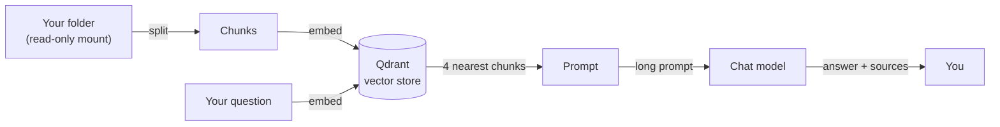

# 06.1 · Wire a local RAG service into the stack

Ask a model something it does not know and it will either say so or make something up. Point it at
your own documents and it has something to read. This module is optional — skipping it removes one
lesson in Module 10 and one capstone criterion and nothing else — and it is deliberately shallow:
four ideas, a paragraph each, and a working system. The depth lives in the `rag-course`; this
module's job is to make the vocabulary and the plumbing familiar.

## Why it matters

Home Assistant already holds your entity names, your areas, and your automations. It does not hold
the warranty that expires in eleven months, the manual's error-code table, or the note where you
wrote down the guest Wi-Fi password. Those are the documents people actually ask a model about,
and they are the ones a model cannot guess.

This is also the module where the CPU's second weakness shows up. Long prompts are processed at
prompt speed, not generation speed, and prompt speed is much lower. A retrieval-augmented question
with 2 000 prompt tokens can take twenty seconds before the first word appears, and the reason is
nothing to do with your model being slow.

## How it works

Four ideas, one paragraph each. This is deliberately the whole theory.

### Chunking

Your document is cut into pieces small enough to fit in a prompt and large enough to mean
something — usually a few hundred words, with some overlap so a sentence split across a boundary
still reads. This is a trade-off, not a tuning trick: chunks that are too small lose the context
that made them answerable, and chunks that are too large bury the answer among irrelevant text.
Chunking is where most "the RAG system is bad" reports actually live.

### Embeddings

Each chunk becomes a list of numbers — a vector — chosen so that chunks meaning similar things land
close together and dissimilar ones land far apart. "Where does my warranty end" and "warranty
expiry date for the washing machine" are different words with the same meaning, and embeddings are
what make that visible. This is why the embedding model is a different model with a different job:
see [17 · One model per job](../module-05/lesson-01.md).

### Retrieval

Your question is embedded with the same model, then compared against every stored chunk, and the
nearest few are handed to the chat model. Qdrant is the vector store here — a small database whose
only job is "give me the nearest things to this vector, quickly". It publishes no port to your
machine; it is reachable only from inside the Docker network.

### Grounding

The retrieved chunks go into the prompt with an instruction to answer only from them. This is the
part that decides whether an answer is *supported*, and it is checkable: you can read the chunks and
see whether the answer is in them. Groundedness is what [22 · Is the answer right?](lesson-03.md)
measures.



Note the direction of the arrows and what they cost. Indexing is many short embedding operations —
CPU-friendly, finishes in minutes. Asking is one embedding plus **one long prompt through the model
server**, and that second step is the expensive one.

## Show me

The stack already contains everything this module needs, behind a profile:

```bash
docker compose --profile rag up -d
```

That starts one extra service, `qdrant`, and nothing else. The embedding model is already running
inside the model server; Open WebUI calls it through the same API. There is no new model to
download and no new port to open, which is the shape this course keeps aiming for: optional means
optional.

## Try it

1. Start the RAG profile and confirm it came up:

   ```bash
   docker compose --profile rag up -d
   docker compose ps
   ```

   Qdrant should show no published port. If yours does, something in your compose file differs from
   `labs/common/compose.yaml` — check before you go further.

2. Point the chat interface at a folder of documents. The sample household folder is mounted
   read-only into the interface already. In the interface: **Workspace → Documents**, then create a
   knowledge base, then upload or connect the folder.

   ```bash
   # where that folder lives inside the container
   docker compose exec open-webui ls -la /data/documents
   ```

3. Set the retrieval parameters before you upload anything, because they are easier to reason about
   before there is an index:

   | Setting | Value | Why |
   |---|---|---|
   | `RAG_EMBEDDING_MODEL` | `nomic-embed-text` (from `.env`) | Already in the stack, 274 MB |
   | `RAG_TOP_K` | 4 | More chunks means a longer prompt and more seconds |
   | `RAG_EMBEDDING_CONTEXT_LENGTH` | 2048 | Fits in a 4096 context alongside your question |

4. Ask a question you know the answer to, and **read the sources it shows you.** This is the whole
   skill: an answer with citations you can check, and an answer without.

   - "When does the washing machine warranty end?"
   - "What do I do if the washing machine shows E3?"
   - "How much was the energy bill in December?"

5. Time it. Watch the gap between "I pressed enter" and "the first word appeared":

   ```bash
   # Windows PowerShell
   Measure-Command { docker compose logs -f open-webui } | Select-Object TotalSeconds

   # or just use the interface and count
   ```

   Write the first-word time in your [measure-yours table](../../templates/measure-yours.md). Then
   ask the same question with `RAG_TOP_K` raised to 10, restart, and time it again. The second
   number will be worse, and now you know by how much.

6. Try a question the folder cannot answer — "what is the capital of Chile?" — and see what it does.
   A grounded system says it does not know. Write down whether yours did.

## Break it

**Break it with a long prompt.** Set `RAG_TOP_K` to 20 with `RAG_EMBEDDING_CONTEXT_LENGTH` at 8192
and ask a normal question. The prompt becomes several thousand tokens, and at the prompt rates this
course cites for a CPU, you will wait a long time before the first word. Nothing is broken. This is
the single most common "my local AI feels awful" cause, and it is invisible if you do not time the
stages separately.

**Break it with the wrong embedding model.** Point the interface's embedding model at a chat model.
It will index, it will return vectors, and retrieval will quietly get worse. Chapter 05's quiz has a
question about exactly this.

**Break it with a huge chunk size.** Set the chunk size to the whole document and re-index. Every
retrieval now returns a whole manual, the prompt is enormous, and the answer is somewhere in it.

**Break it with a stale index.** Add a document to the folder and ask a question only it can
answer. The interface cannot see it, because the folder is mounted but nothing re-indexed it. This
is not a bug and it is [21 · Which folders to index](lesson-02.md)'s subject.

## Fix it

| Symptom | Cause | Fix |
|---|---|---|
| Long wait before the first word | Too many chunks, or too large a chunk size | Lower `RAG_TOP_K` to 3–4; chunk around 300 words with overlap |
| Answer is fluent and wrong | Retrieval returned the wrong chunk, not the model's fault | Read the sources; if they are wrong, fix chunking or the embedding model |
| Answer correct but from its own knowledge | The sources were not in the prompt | Check the knowledge base is attached to that chat, not merely uploaded |
| Indexing takes forever | A large embedding model, or a huge folder | Use `nomic-embed-text`; index in batches; do it once |
| A new file is invisible | The index was not refreshed | Re-ingest; make it a habit or a script |
| Container cannot reach Qdrant | Wrong service name | `http://qdrant:6333` on the same internal network |

The general rule: **when retrieval feels wrong, check what was retrieved before you blame the
model.** It is almost always the chunking or the folder, and the model is the last thing in the
chain.

## How do I know it works?

- [ ] `docker compose ps` shows Qdrant running with no published port.
- [ ] The sample folder is indexed, and you can see the number of chunks.
- [ ] You have asked three questions and read the cited sources for each.
- [ ] You have timed the first-word delay for a knowledge question and written it down.
- [ ] You have tried a question the folder cannot answer, and you know what it did.

## Use it when / avoid it

**Use retrieval** when the answer is in a document and you need to be able to show where it came
from. It is the only way a small local model gives a *checkable* answer.

**Do not use it to memorise facts you could put in a prompt.** A 40-word system prompt is faster,
cheaper and more reliable than any number of retrieved chunks.

**Skip this module entirely** if your use of the stack is chat and voice control. It costs one
lesson in Module 10 and one capstone criterion, and nothing in the rest of the course depends on
it. That is a legitimate choice, not a shortcut.

**Do not point a retrieval system at a folder you would not put in a cloud service** until
[21 · Which folders to index](lesson-02.md) has taught you which folders that is.

> [!TIP]
> **Go deeper.** `rag-course` teaches chunking strategies, hybrid and lexical search, reranking,
> abstention, evaluation and RAG security in depth. This module gives you the vocabulary and a
> working system so you can read that course without starting from nothing — and so you can debug
> your own stack before you go looking for depth.

## Reflect

1. In your own words, what does an embedding do that a keyword search cannot?
2. You timed a knowledge question at eighteen seconds and a plain chat question at four. Where did
   the extra fourteen seconds go, and which setting would you turn to reduce it?
3. If you skipped Module 6, what would you have lost, concretely? If you did not skip it, what is the
   first question you would ask that the sample folder cannot answer about your own house?

## Sources

- [Qdrant documentation](https://qdrant.tech/documentation/)
- [Open WebUI documentation](https://docs.openwebui.com)
- [Pinned models and licences — embedding models](../../references/models.md)
- [Benchmark numbers and where they come from](../../references/benchmarks.md)
- [17 · One model per job](../module-05/lesson-01.md)
- [21 · Which folders to index](lesson-02.md)
- [22 · Is the answer right?](lesson-03.md)