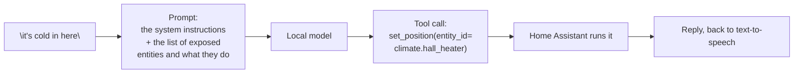

# 10.1 · The Ollama conversation agent

Home Assistant's built-in intents understand a fixed vocabulary. A conversation agent replaces that
with a language model that reads the sentence, looks at what the house can do, and decides. This is
the lesson where the stack becomes an assistant rather than a remote control.

## Why it matters

"Somewhere off" is not a sentence a fixed grammar has. Neither is "it's cold in here", or "what did
I leave on last night". A conversation agent handles all of them, because it does not have to
match a phrase — it has to decide.

It also introduces everything this module is about: a model that can be wrong in a way a grammar
cannot. The tool list goes into the prompt, a small model has to pick from it correctly, and the
result is an action taken in your house. This lesson sets it up; the next three are about keeping
it trustworthy.

## How it works

### From sentence to tool call



The model never touches an entity. It emits a **structured request** — a tool call with a function
name and arguments — and Home Assistant validates and runs it. That boundary is the most important
thing in this lesson: the model proposes, the system disposes.

### What goes into the prompt

Three things, and the second is the one people underestimate:

1. **System instructions** — who the assistant is, what it is allowed to do, how to reply.
2. **The exposed entity list**, each with its name and what it does. This is the tool list.
3. **Your sentence.**

Home Assistant's own documentation advises keeping that list small — it recommends exposing fewer
than 25 entities — and warns explicitly that small models make mistakes with it. That is not
caution from a vendor; it is the same bandwidth-and-context arithmetic from Module 2. A long tool
list is prompt tokens, and prompt tokens are seconds before the first word.

### What it is good at, and what it is not

| Good at | Bad at |
|---|---|
| "It's cold in here" → the right climate entity | Anything requiring precise arithmetic about many entities |
| "What did I leave on?" → a query | A command with a consequence and no confirmation |
| Open-ended phrasings of fixed intents | Consistently choosing between 40 near-identical tools |
| Explaining what it just did | Knowing a value it has never been told |

The second column is the reason Module 10.3 exists.

## Show me

The configuration on both sides. On the stack:

```dotenv
# labs/common/.env
TOOL_MODEL=qwen3:4b
```

In Home Assistant, an Ollama conversation agent pointed at your own model server:

```yaml
# via the integration: Settings -> Devices & services -> Ollama
conversation_agent:
  - platform: conversation_ollama
```

```bash
# verify Home Assistant can reach the model server at all, from inside its own network
docker compose exec homeassistant python3 -c \
  "import urllib.request;print(urllib.request.urlopen('http://ollama:11434/api/version').read())"
```

The address is `http://ollama:11434` — a service name, on the internal network, with no published
port. Home Assistant reaches the model the same way the chat interface does, and for exactly the
same reason: it is safer and it is simpler than publishing an unauthenticated API.

## Try it

1. Add the Ollama integration in Home Assistant, point it at the model server, and select a
   **tool-capable** model. Then set it as the conversation agent on your assistant.

2. Start with three exposed entities, not twenty. The kitchen light, the hall heater and one
   temperature sensor. You want to be able to see what goes wrong.

3. Try the phrases that built-in intents cannot do:

   ```text
   it's cold in here
   can you make it a bit warmer
   what did I leave on
   turn everything off except the hallway
   ```

   Some will work. That is expected, and the failure rate is what the next lessons measure.

4. **Read the tool calls.** This is the habit that makes the rest of the module possible. In
   **Developer Tools → Conversation**, or in the assistant debug log, you can see the prompt and the
   model's chosen tool with its arguments. For each of the four phrases above, write down:

   ```text
   Phrase: it's cold in here
   Tool:   set_position
   Args:   entity_id=climate.hall_heater, position=21
   Right?  yes
   ```

   You are looking for the moment where the model's choice is *understandable but wrong* — the
   bedroom heater instead of the hall, or 21 degrees instead of 19. Those are the interesting rows.

5. Grow the exposure one entity at a time and re-run. Watch the misfire rate rise, and watch *which*
   commands break. The list growing is the cause, not the model getting worse.

6. Record where it stands before you go further: on your three-entity setup, out of the ten
   command set, how many did the model get right?

## Break it

**Break it with a large entity list.** Expose everything. The prompt grows, prompt processing takes
longer, and the model has more near-identical tools to choose between. Answers get worse on a CPU
with the same model that was fine with five entities.

**Break it with a model that cannot call tools.** Point the conversation agent at a base model or a
small one without tool support. It chats beautifully and never changes anything, or it emits
something malformed that Home Assistant rejects. Nothing says "wrong model" in the logs.

**Break it by having two Ollama installs.** A native one on the host and the Compose one in the
stack. Home Assistant reaches the container; your tests reach the host; you spend an evening
comparing two behaviours.

**Break it with a context too small for the tool list.** Set the model's context to 2048 and expose
twenty entities. The tool list is truncated, and the model cannot see half of what it is allowed to
do.

## Fix it

| Symptom | Cause | Fix |
|---|---|---|
| Chats but never acts | Model cannot call tools | Use a tool-capable model |
| Acts on the wrong entity | Too many similar tools exposed | Expose fewer; give things distinct aliases |
| Takes several seconds before acting | Long tool list | Fewer entities, or a smaller model |
| Connection refused from Home Assistant | Wrong address | `http://ollama:11434`, not `127.0.0.1` |
| Acts correctly in the chat UI, not in Assist | The assistant's conversation agent is still Home Assistant | Change the assistant's conversation agent |
| It half-works, unpredictably | Context too small for the tool list | Raise the model's context, or expose fewer entities |

The general rule: **every "the model is bad at this" report should first be checked against the size
of the list it was given.**

## How do I know it works?

- [ ] Assist answers an open-ended phrase and changes the right entity.
- [ ] You have read at least four tool calls in the logs and written down what each one did.
- [ ] You can name one phrase where the model chose understandably and wrongly.
- [ ] Your exposure list is deliberately small, with a reason for each entry.
- [ ] Home Assistant reaches the model server by service name, on an internal network.

## Use it when / avoid it

**Use a conversation agent for open-ended phrasing.** "It's cold in here" is exactly what it is for.

**Keep the entity list short.** Under about 25, per Home Assistant's own guidance, and fewer if
your model is small. Every entry is prompt tokens and a chance to choose wrongly.

**Use a tool-capable model.** Verify the capability rather than assuming it from a model card.

**Avoid using it for actions with consequences** until lesson 10.3 has given you a guardrail
pattern. The model's proposal is checked by Home Assistant; it is not checked by taste.

> [!NOTE]
> Home Assistant also supports exposing **scripts** to a model, which is often a better tool than a
> raw entity: "set movie mode" can be one script that does four things, rather than four tools the
> model has to sequence correctly. That reduces both prompt length and the chance of a partial
> sequence.

## Reflect

1. Read four tool calls and write down what each did. How many were right, and how were the wrong
   ones wrong?
2. If you exposed ten more entities, which of your working commands would you expect to break?
3. Which of your household's real phrases would built-in intents handle, and which need a model?

## Sources

- [Home Assistant — Ollama integration](https://www.home-assistant.io/integrations/ollama/)
- [Home Assistant LLM API — how intents become tools](https://developers.home-assistant.io/docs/core/llm/)
- [Home Assistant — exposing scripts to LLMs](https://www.home-assistant.io/voice_control/exposing_scripts_to_llms/)
- [Home Assistant — best practices with Assist](https://www.home-assistant.io/voice_control/best_practices/)
- [Pinned models and licences](../../references/models.md)
- [34 · Intents first, LLM as fallback](lesson-02.md)