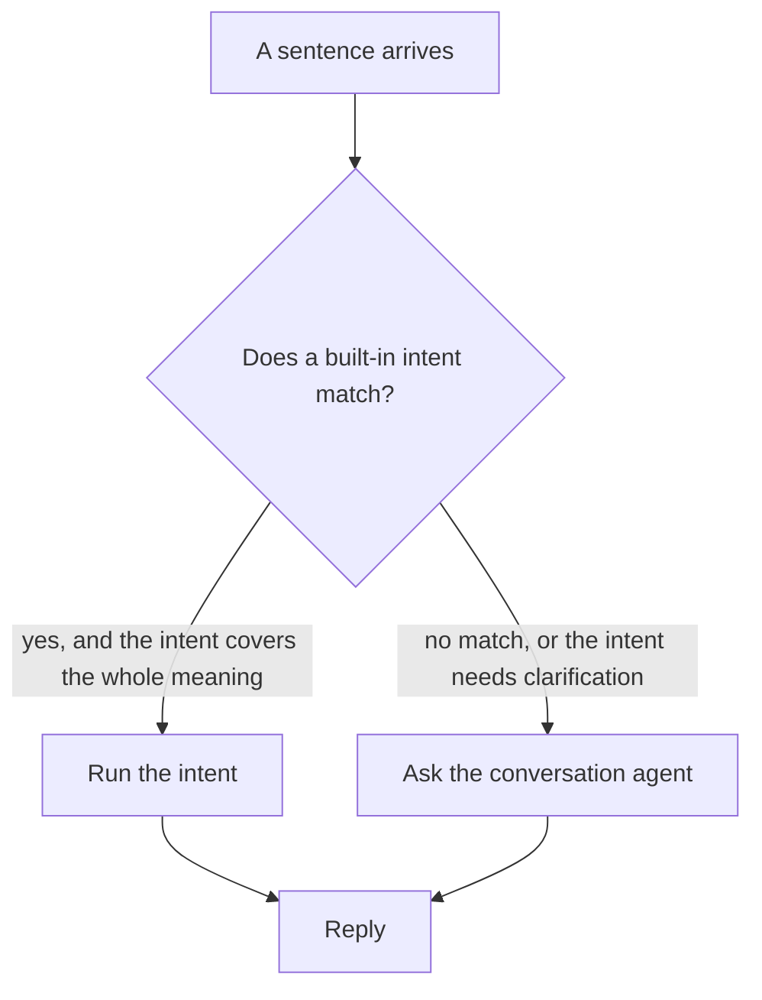

# 10.2 · Intents first, LLM as fallback

The pipeline has two ways to act on a sentence, and this lesson is about which one runs first. The
answer is the single most valuable design decision in the course, and it costs one setting.

## Why it matters

The two paths have very different profiles:

| | Built-in intent | Conversation agent |
|---|---|---|
| Latency | ~100 ms | seconds |
| Wrong answers | Fails loudly, acts on nothing | Acts on the wrong thing |
| Handles "it's cold in here" | No | Yes |
| Cost of a mistake | A failed command | A wrong action in your house |

Notice the last row. That asymmetry is the entire argument. An intent that fails does nothing; a
model that fails does something plausible. In a system where one of the actions can open a door,
you want the fast, deterministic path to get first refusal, and the model to handle only what it is
good at.

The cost of this design is a second configuration and a slightly slower worst case, and both are
worth it.

## How it works

### The decision



The key word is **covers**. If a sentence matches an intent only partially — "turn off everything"
matching an `all off` intent that does not include the heating — the right behaviour is to fall
through to the model, not to act on the partial meaning. Most built-in intents are strictly
narrower than their phrasings suggest, and this is worth checking rather than assuming.

### Where the setting lives

Home Assistant's Assist pipelines are the mechanism. A pipeline is an ordered list of stages:
wake word → speech-to-text → conversation agent → text-to-speech. You can define more than one and
switch between them.

The practical shape for a home lab is two assistants, sharing the same speech services:

| | Conversation agent | Used for |
|---|---|---|
| **Fast assistant** | Home Assistant (intents only) | Control, timers, lists |
| **Assistant with a brain** | A local model | Everything else |

Or, inside one pipeline, configure the model agent as a fallback rather than as the only handler,
where your version supports it. Either way the invariant is the same: **a sentence that a fixed
intent can handle completely never reaches the model.**

### Why the latency difference is large

Built-in intents run entirely inside Home Assistant: a sentence match and a service call, with no
model in the path at all. The conversation agent adds a full generation before anything happens,
and on a CPU that is seconds — as your own Module 8 measurements will confirm. The two paths differ
by roughly an order of magnitude, which is the difference between a command that feels immediate
and one you wait for.

## Show me

The numbers to reproduce on your machine. From your [latency
budget](../../templates/latency-budget.md), the intent path measured under 2 s and the model path
around 5–7 s on a typical 4B model:

| Path | What it handles | Time to action | Can it act wrongly? |
|---|---|---|---|
| Intent | "turn on the kitchen light" | ~0.1 s | no — it fails instead |
| Model | "it's cold in here" | several seconds | yes |
| Model, fell through | "turn off everything except the hall" | several seconds | yes |

The third row is the one that needs care. A phrase that *sounds* like a simple command but does not
match an intent goes straight to the model, which will happily do something more than you meant.

## Try it

1. Run the thirty-command set through the **intent-only** path and score it. Almost everything will
   either work or fail cleanly:

   ```text
   Mode: intents only
   correct      __ /30
   wrong action __ /30
   refused      __ /30
   missed       __ /30
   ```

   **Wrong action should be zero.** If it is not, something in your exposure list is mapped onto an
   intent more broadly than you thought, and that is a finding.

2. Run the same thirty through the **model** path. Now fill in the same four columns. Expect more
   correct answers on the ten question-type commands, and more wrong actions overall.

3. Run the hybrid: intents first, model as fallback. The score you want is:

   ```text
   correct      __ /30     at least as high as intents alone
   wrong action __ /30     ideally lower than the model alone
   ```

   If the hybrid's wrong-action count is not lower than the model's, the intents are not being
   matched first. Check the pipeline order.

4. Measure the latency difference with the same command in both modes:

   | Command | Intent path | Model path | Difference |
   |---|---|---|---|
   | turn on the kitchen light | | | |
   | it's cold in here | n/a | | |
   | what did I leave on | n/a | | |

   Write both in your measure-yours table. This is the capstone's voice criterion.

5. Find a phrase that matches an intent *partially* and check what the hybrid does with it. "Turn
   off everything" is the classic case. If the intent fires and the heating stays on, the model
   never gets a chance to notice — and if that is what you want, say so in a custom sentence
   instead.

6. Write your decision in one line: which path is the default, and which phrases you have made sure
   land on the other one.

## Break it

**Break it with the model as the only handler.** Every "turn on the light" now takes seconds. The
household stops using voice for control and starts using the dashboard, and the model path ends up
judged by the commands it was always going to get right.

**Break it with the model as a fallback that never fires.** If the intent matcher matches
something too loosely, every sentence is "handled" and the model is never asked. The symptom is an
assistant that answers "turn off everything" by turning off a light, with confidence.

**Break it by measuring only the happy path.** Average the two modes together and the number looks
reasonable. Report them separately or the measurement is useless.

**Break it by assuming partial matches are safe.** An intent that matches "turn off" but does not
cover what you meant is worse than no match, because it acts.

## Fix it

| Symptom | Cause | Fix |
|---|---|---|
| The model handles everything | It is the only conversation agent | Put Home Assistant first in the pipeline |
| The model never handles anything | Intents match too loosely | Tighten exposure; use custom sentences |
| Intent actions are wrong | Partial match | Custom sentences, or fall through to the model |
| Intent path is slow | It is not the intent path | Check the exposure list and the machine |
| Model path is very slow | Model or entity list too big | Smaller model, or fewer entities |

The habit worth forming: **whenever you add a sentence that the model handles well, consider
whether it belongs as a custom sentence instead.** Each one you move removes latency and removes a
possible misfire at the same time.

## How do I know it works?

- [ ] Your wrong-action count in intents-only mode is zero, or you can explain every exception.
- [ ] The hybrid's wrong-action count is lower than the model-only count, proving intents run first.
- [ ] The hybrid's correct count is at least as high as intents-only, so nothing was lost.
- [ ] You have measured both paths on the same command and written both figures down.
- [ ] You have written one line naming your default path and the phrases you sent to the other.

## Use it when / avoid it

**Put intents first, always.** It is faster, it is deterministic, and its failure mode is doing
nothing, which is the right failure mode for a device in your home.

**Fall through to the model for open-ended phrasing.** That is what it is for.

**Keep a text-only route into the model path** for questions, where latency does not matter as
much and the answer quality does.

**Avoid measuring the two paths as one number.** They are different systems with different failure
modes, and the capstone asks for both.

> [!TIP]
> Every phrase you move from the model to a custom sentence is latency and a misfire removed, with
> no capability lost. The thirty-command set from [the sample folder](../../labs/common/) is the
> checklist for deciding which.

## Reflect

1. What were your wrong-action counts in the three modes, and why did the hybrid come out where it
   did?
2. Which of your household's real phrases would be better as custom sentences than as model
   decisions?
3. What is the latency difference between your two paths, and does it justify the extra
   configuration?

## Sources

- [Home Assistant — Assist pipelines](https://www.home-assistant.io/voice_control/pipelines/)
- [Home Assistant — setting up a fully local voice assistant](https://www.home-assistant.io/voice_control/voice_remote_local_assistant/)
- [Latency budget template](../../templates/latency-budget.md)
- [Sample command set](../../labs/common/)
- [35 · Tools and guardrails](lesson-03.md)