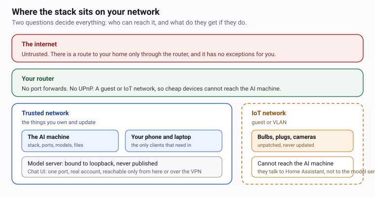

# 11.1 · Threat-model your home AI stack

The last two modules made your stack genuinely useful, which means it is now worth something to
somebody else. This lesson is the twenty-five minutes where you work out what — on paper, before
you change a single bind address in the next one.

> [!IMPORTANT]
> The course's measurement spike has not run yet, so nothing in this module says "we measured".
> Where a lesson shows output it is either quoted from the linked source, or it is a command for
> you to run and the thing to look for in the answer. Every "Show me" block says which one it is.

## Why it matters

By the end of Module 10 you had built a machine that holds three things a stranger wants: a
free inference server that never sleeps, an index of your own documents, and the ability to act on
your house. Those are three different assets sitting on one box on your LAN, and until you have
them written down as a list you cannot tell which mistake matters and which does not.

The instinct most people bring is "it is behind my router, so nobody can get in". That instinct is
half right and entirely untested, and the half that is wrong is the half that ends up on the
internet. A home router's NAT is not a security control you administer; it is a default that
changes when a TV asks for it, when a game console uses UPnP, when you install something to get
around a problem, and when somebody on your guest Wi-Fi is running a port scanner.

## How it works

### Four zones, and the only question that matters about each



| Zone | Who is in it | What it can reach today | What you want it to reach |
|---|---|---|---|
| **The internet** | Anyone, including automated scanners | Your router, and any port you forwarded | Nothing, ever |
| **Your router** | Its own admin page, UPnP, the forward table | Every device in the house | No forwards, UPnP off |
| **Trusted LAN** | Your laptop, your phone, the AI machine | The one published chat port | One authenticated port, or none |
| **IoT / guest** | Bulbs, plugs, cameras, a TV | Home Assistant, the internet, each other | Never the AI machine |

Reachability is decided by a chain, and every link is a chance for it to be longer than you think.
A request from the internet reaches a service only if all of these are true: a port is forwarded (or
UPnP opened one), the router is the address being reached, the operating system is not filtering,
and the service is bound to an address the request can land on. You do not need to break all four —
you need to be certain about every one, which is why the next lesson checks the last link
mechanically instead of trusting your memory.

### What an attacker actually gets

| Asset | Why it is worth something | What it costs you |
|---|---|---|
| **Compute** | An inference host on your broadband, free to use, always on | A full disk, a hot machine, a slower network, a bill |
| **Your indexed files** | The chat and RAG services read whatever folder you pointed them at | Documents quoted back out of a conversation |
| **Chat history** | Whatever you asked it, including things you did not mean to write down | Exported through one API call |
| **Your house** | Home Assistant turns sentences into actions | Tool calls on locks, covers and the garage door |
| **A foothold** | The documented remote-code-execution bugs in the model server run *inside your LAN* | Every other device reachable from that container |

The last row is the one people miss. A cloud account breach is contained by somebody else's
infrastructure. An unauthenticated remote-code-execution bug in a container on your trusted network
is not: that code runs with the reach of your network position, not with the reach of a login.

### Why a home AI box is not a cloud account

|  | A cloud AI account | Your home AI box |
|---|---|---|
| Front door | A login, with rate limits and audit logs | Often no authentication at all |
| Where it runs | Inside somebody else's perimeter | On your LAN, where every other device trusts it |
| Who watches it | A security team and automated abuse detection | Nobody, unless you are that person |
| Lifetime | As long as the provider keeps your account | As long as the machine is plugged in |
| What it holds | What you chose to put there | Documents, history, and a key to the house |

The model server is the sharpest example. Its API has **no authentication at all** — anyone who
reaches it can list, pull and delete models and use the compute, which is stated in Ollama's own
FAQ. And this is not theoretical exposure: Cisco reported finding 1 100+ internet-exposed Ollama
servers through Shodan, with later counts reported around 175 000 and around 300 000. The count
grew because the mistake is a one-line environment variable, and people make it for a good reason —
so that a container on another machine can reach it.

### The rule, and the method for re-deriving it

**One rule removes most of this: nothing in the stack is reachable from the internet.** Not the
model server, not the chat interface, not Home Assistant. Home Assistant's own documentation says
plainly that simply opening a port is not secure, and points at a cloud relay, a VPN, or a
correctly configured reverse proxy instead. This course takes the VPN path in
[39 · Remote access the safe way](../module-11/lesson-03.md).

A second rule does most of the remaining work: **nothing with an unauthenticated API is reachable
from anything you do not control.** At home, "you do not control" means the IoT network — a bulb
you got in a bargain box, a camera with a vendor app, a smart TV — which is the subject of
11.3.

The method behind both rules is four questions, and you should be able to answer them for any
service you add:

1. **Who can open a connection to it?** Name the zones, not the devices. "Everyone on the trusted
   LAN" is an answer; "my phone" is not, because the phone also connects to guest Wi-Fi at a
   friend's house.
2. **What do they get if they do?** A model list, a document index, a chat log, a tool that opens a
   door.
3. **What would they need next?** A credential, a bug, or patience. This is the question that turns
   a list into a threat.
4. **Which one control breaks the most chains?** Not which control is strongest — which one, if you
   got it right, would remove most of the rows above.

> [!TIP]
> For the attack side of this — how inference APIs and model files actually get attacked — Tal's
> `ai-security-course` is where to go next. This module teaches the home-network defence; that
> course teaches the techniques. Read this module first, because its vocabulary is the vocabulary
> used there.

## Show me

The course's own stack, worked through on paper. The two facts it is built on come from the
Compose file you have been running since Module 3, and from Ollama's documentation — not from a
measurement.

| Service | Reachable by | Authentication | What is at stake |
|---|---|---|---|
| `ollama` (model server) | Containers on `homelab-ai` only; no host port is published | **None** | Model list, compute, model files, documented RCE bugs |
| `open-webui` (chat) | `127.0.0.1:8080` on the host | A local account | Chat history, and a proxy path to the model server |
| `homeassistant` | Containers on `homelab-ai` and `homelab-voice`; no host port | A local account | Tool calls on your house |
| `wyoming-*` (voice) | Containers on `homelab-voice`; no host port | **None** | Your microphone audio, in transit |
| `qdrant` (optional) | Containers on `homelab-ai`; no host port | **None** | The vector index of your own files |

Now the four questions, answered for the row that matters most. *Who can connect?* Only other
containers on `homelab-ai`, because no `ports:` line exists for that service. *What do they get?*
Everything in the model server, with no credential. *What would they need next?* Nothing — there is
no next step, the access is already complete. *Which one control breaks the most chains?* The
absence of a published port. That is why `compose.yaml` has no `ports:` line under `ollama`, and
why `homelab.py doctor` treats any stack port that answers on a non-loopback address as a failure.

## Try it

1. Draw your own four-zone map. Use the diagram above as the template, and fill in what is *actually*
   on each network at your house — not what you intended.

2. Fill this in for every service in your stack, from `docker compose ps`:

   ```text
   service:      ollama
   host ports:   (none published)
   bound to:     not published; reachable only on homelab-ai
   authentication: none
   gives away:   model list, compute, model files
   who can reach it: containers on the ai network
   ```

3. Check what your machine is actually listening on, from the machine's own point of view:

   ```bash
   # Windows PowerShell
   Get-NetTCPConnection -State Listen | Select-Object LocalAddress, LocalPort, OwningProcess |
     Sort-Object LocalPort | Format-Table -AutoSize

   # macOS / Linux
   ss -tlnp
   ```

   Write down every address that is not `127.0.0.1` and not `::1`. You are not judging them yet;
   you are collecting them.

4. Read your router's settings and write down, in one line each: is UPnP on, and what ports are
   forwarded and to which address. Do not change anything yet — this lesson only reads. Module 11.3
   is where changes get made, and it opens with a warning for a reason.

5. Name the single most valuable thing on your AI box, and write down who would want it. Most
   people answering honestly say "the documents I indexed", and most people are then surprised
   that nobody ever thought about the port.

6. Add one row you were not expecting. Every stack does.

## Break it

**Break it with "it's behind NAT".** The argument sounds complete and is missing four links. UPnP can
open a port without you. A port forward you added for a game, a camera, or a working-around-a-
problem session is still open. Anything on the guest Wi-Fi is already inside your perimeter. And a
host firewall rule you added once for a debugging session may be gone. None of these requires an
attacker to be clever; they require an attacker to wait and press a button that already exists.

**Break it with "it's only a local model, there is nothing secret in it".** The model server is the
least interesting thing on the box. It is a proxy in front of the chat history, the document index,
and — through Home Assistant — the tools that open your house. Protecting only the model is like
locking the garden gate and leaving the door open.

**Break it with "I will look at it if something happens".** There is no log of an intruder on a home
box. The service answers, the answers are wrong, and you find out from a corrupted document three
months later. Detection is not the control here; reachability is.

## Fix it

| Symptom | Cause | Fix |
|---|---|---|
| A service answers on your LAN address | Bound to `0.0.0.0`, or published without a bind address | Bind to `127.0.0.1`, or to a VPN interface address — 11.2 and 11.3 |
| A port is open that you did not add | UPnP, or a forward someone made earlier | Turn UPnP off and remove forwards you do not recognise — 11.3 |
| The model server is reachable from a container | That is by design, but from the *host* it is not | Keep it off every `ports:` line; keep the network `internal: true` |
| A cheap bulb can reach the AI box | Everything is on one flat network | Guest network or VLAN for IoT, with client isolation — 11.3 |
| Home Assistant is reachable from the internet | A forward, a cloud relay, or a tunnel | Remove it; VPN only — 11.3 |

The general form of the answer is the same in all five rows: **remove the reachability, do not try
to authenticate your way out of it.** The model server has no authentication to strengthen, the
voice services have none either, and adding a password to the wrong service is work that looks like
security and is not.

## How do I know it works?

- [ ] You have written, per service, who can reach it and what they get — from `docker compose ps`,
      not from memory.
- [ ] You have read your router's forward table and UPnP setting and written down what you found.
- [ ] Every address your machine listens on that is not loopback has a sentence attached to it
      explaining why.
- [ ] You can name the most valuable thing on the box and who would want it.
- [ ] You can state the one rule: nothing here is reachable from the internet.
- [ ] You have filled in the first page of
      [the security checklist](../../templates/security-checklist.md).

## Use it when / avoid it

**Redraw the map when you add a service, not when you feel like it.** Every new container is a new
row in the table, and the question is the same two minutes long. The services most people forget are
the ones that arrive with a module and are useful immediately: the vector store, the Wyoming
services, an add-on in Home Assistant.

**Redraw it after any router change.** A firmware update, a new port forward for something else, a
switch from a router to a mesh system, or a visit from a relative who "fixed" the Wi-Fi are all
events that can add a route to your stack without you touching a single course file.

**Avoid treating this as a one-time document.** Its value is that it is short enough to redo. A
threat model that took a day to write and is never revised is worse than useless, because it looks
like a control and is not.

**Avoid running two stacks you do not both own on one network.** If somebody else is building a
home AI lab on your LAN, the cheapest useful thing you can do is tell them where their published
ports are.

## Reflect

1. Take the single most valuable asset from your table. What is the shortest path an outsider could
   take to it, and which link in that path would you fix first?
2. Your machine listens on a non-loopback address that you cannot explain. What do you do before
   you understand it, and why is that the right order?
3. The rule is "nothing reachable from the internet". What does that rule *not* protect you from,
   and which of the other zones is the realistic version of that attack?

## Sources

- [Cisco — detecting exposed Ollama servers with Shodan](https://blogs.cisco.com/security/detecting-exposed-llm-servers-shodan-case-study-on-ollama)
- [Twingate — Ollama server exposure counts](https://www.twingate.com/blog/ollama-server-exposure)
- [NYU Shanghai RITS — Bleeding Llama, and a reported count of 300 000 exposed servers](https://rits.shanghai.nyu.edu/ai/bleeding-llama-critical-unauthenticated-memory-leak-hits-300000-ollama-servers/)
- [Ollama FAQ — the API has no authentication; host, context size and keep-alive](https://docs.ollama.com/faq)
- [Home Assistant — remote access, and why opening a port is not secure](https://www.home-assistant.io/docs/configuration/remote/)
- [The shared stack's Compose file](../../labs/common/compose.yaml)
- [Security checklist](../../templates/security-checklist.md)
- [38 · Bind addresses and ports](../module-11/lesson-02.md)
